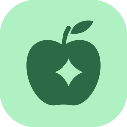
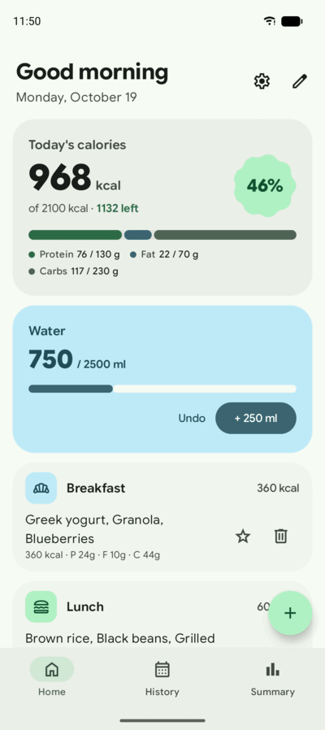
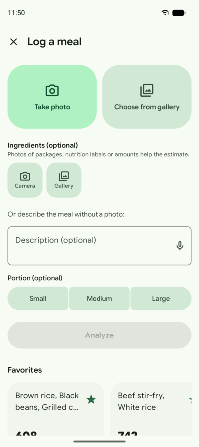
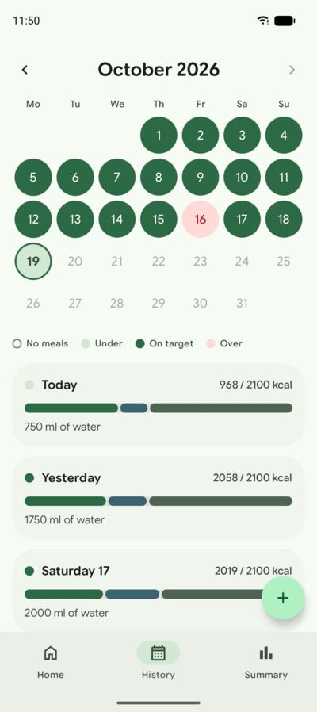
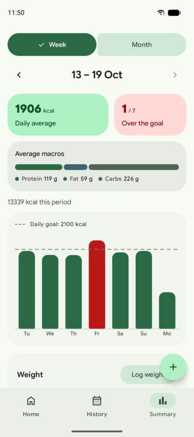
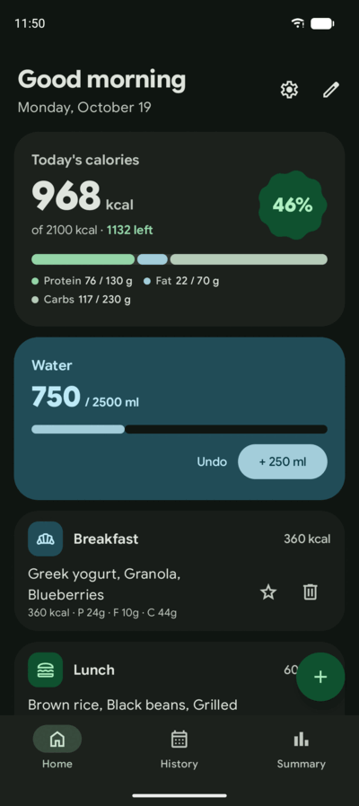
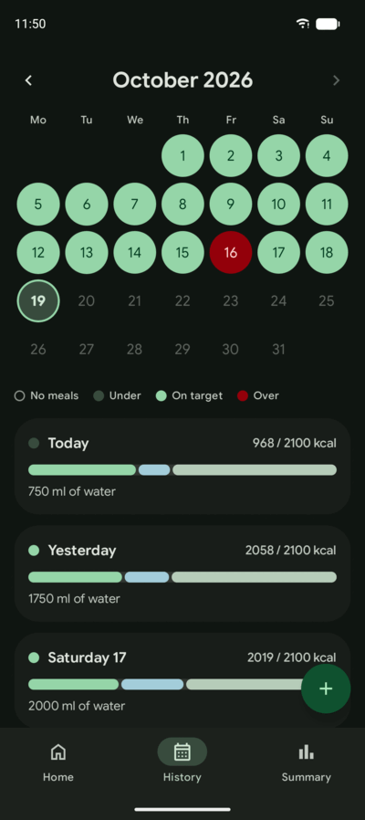
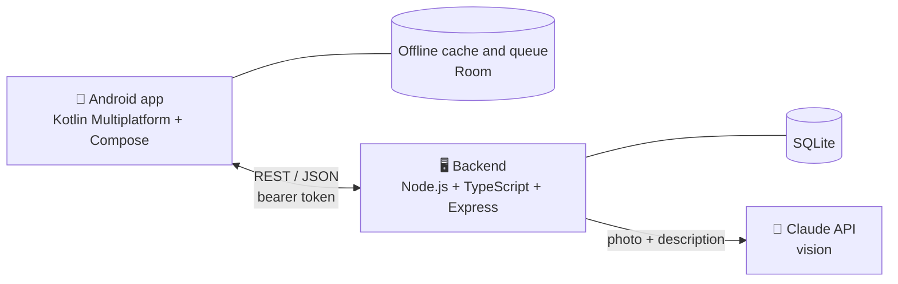

<p align="center">
  
</p>

<h1 align="center">Food Tracker</h1>

<p align="center">
  Snap a photo of your meal and get an AI estimate of its foods, calories and macros.<br>
  Review it, save it, and follow your days against your goals.
</p>

<p align="center">
  <a href="https://github.com/crmartinez930130/food-tracker-ai/actions/workflows/ci.yml"></a>
  <a href="LICENSE"></a>
  
  
  
  
  
  
  
</p>

Personal and single-user: the app talks to a small backend that runs on your own computer, on your home network. No cloud deployment, no accounts.

## Screenshots

<table>
  <tr>
    <td align="center"><br><sub><b>Today</b> · calories, macros and water</sub></td>
    <td align="center"><br><sub><b>Log a meal</b> · photo, text or both</sub></td>
    <td align="center"><br><sub><b>History</b> · each day against the goal</sub></td>
  </tr>
  <tr>
    <td align="center"><br><sub><b>Summary</b> · weekly and monthly trends</sub></td>
    <td align="center"><br><sub><b>Dark mode</b> · Today</sub></td>
    <td align="center"><br><sub><b>Dark mode</b> · History</sub></td>
  </tr>
</table>

<sub>Screenshots use made-up sample data.</sub>

## Features

- 📸 **Photo analysis** — Claude's vision model breaks a meal photo down into foods with estimated grams, calories, protein, fat and carbs. Add photos of packages or labels, a typed or dictated description, or a portion size to sharpen the estimate.
- ✏️ **Review before saving** — nothing goes into your history until you check it. Edit any item, and correct saved meals later.
- 🎯 **Goals** — daily targets for calories, macros and water; Home shows how today is going.
- 📅 **History** — a month calendar colored by how each day went, with a detail screen for any day.
- 📊 **Summaries** — weekly and monthly averages, macros and a daily calories chart.
- 💧 **Water** and ⚖️ **weight** — one-tap water logging and a weight trend next to what you eat.
- ⭐ **Favorites** — log a meal you repeat without analyzing it again.
- 🔔 **Reminders** — optional, quiet daily reminders for breakfast, lunch and dinner.
- 📴 **Works offline** — recent days stay on the phone, and meals and water logged without a connection are sent once the backend is back.
- 📤 **CSV export** — take your meal history to a spreadsheet.
- 🌗 **Light and dark**, 🌐 **English and Spanish**.

## How it works



The app never talks to Claude directly: every analysis goes through the backend, the only place that holds your Anthropic API key. The backend stores your history in a single SQLite file on your machine.

## Tech stack

| | |
| --- | --- |
| **App** | Kotlin Multiplatform, Compose Multiplatform (Material 3 Expressive), Ktor client, Room, CameraX, kotlinx.serialization |
| **Backend** | Node.js, TypeScript, Express, Drizzle ORM, better-sqlite3, sharp, Zod |
| **AI** | Claude vision through the Anthropic SDK, with structured output |
| **Quality** | Vitest, kotlin.test, GitHub Actions CI, an automated Claude PR reviewer, OpenSpec |

## Backend

The app needs the backend running first. You need **Node.js 20 or newer** and an [Anthropic API key](https://console.anthropic.com/).

### Setup

```bash
cd backend
npm install
cp .env.example .env
```

Edit `backend/.env` and set your Anthropic key and an access token of your own:

```
ANTHROPIC_API_KEY=sk-ant-...
API_TOKEN=<a random value of at least 16 characters, e.g. the output of `openssl rand -hex 24`>
```

The server refuses to start without `API_TOKEN`. Every `/api` request must send it as `Authorization: Bearer <token>`; in the app, enter the same value in Options → Server → Access token.

Optional settings in `.env` (defaults shown): `ANTHROPIC_MODEL=claude-opus-5`, `HOST=0.0.0.0`, `PORT=3000`, `DB_PATH=data/food-tracker.sqlite`, `ANALYZE_RATE_LIMIT_PER_MINUTE=20` (meal analyses accepted per minute; each one is a paid API call).

### Run

```bash
npm run dev      # watches and restarts on changes
# or
npm run build && npm start
```

Database migrations run automatically on startup. To apply migrations without starting the server: `npm run db:migrate`. After changing `src/db/schema.ts`, generate a new migration with `npm run db:generate` and commit the generated SQL file under `src/db/migrations/`.

### Test

```bash
npm test
```

### Reaching the backend from your phone

The server binds to `0.0.0.0` by default, so it's reachable from other devices on your home network — not just `localhost`. Find your machine's LAN IP (e.g. `hostname -I` on Linux, or check your network settings) and enter `http://<that-ip>:3000` in the app's Options → Server, together with your access token. An Android emulator on the same machine reaches it at `http://10.0.2.2:3000` (the emulator's alias for the host's `localhost`); a phone on the same Wi-Fi needs the actual LAN IP.

### Backing up your data

There is no automatic backup. The entire history lives in `backend/data/food-tracker.sqlite`. To back it up, just copy that file somewhere safe while the server is stopped (or use SQLite's `.backup` command if you want to do it while running).

## Android app

The Kotlin Multiplatform + Compose Multiplatform app lives in `frontend/`: the `composeApp` module has the screens, widgets and Android integration, and the `shared` module the logic without UI (models, API client, local cache and offline queue, the day's calculations). Android is the supported target: the iOS targets are declared in the Gradle build, but there is no Xcode project yet and they aren't built or tested.

### Requirements

- **JDK 17 or newer** (CI uses 21). Gradle uses `JAVA_HOME`, or the `java` on your `PATH`.
- **Android SDK** with the Android 16 platform (API 36). Point Gradle to it with `ANDROID_HOME`, or with a `frontend/local.properties` file (git-ignored) containing `sdk.dir=/path/to/Android/Sdk`. Android Studio creates that file when you open `frontend/`.
- An **emulator or phone running Android 8.0 (API 26) or newer**, with USB debugging enabled for a phone.

The Gradle wrapper (`./gradlew`) downloads Gradle and every dependency on the first run.

### Build and install

```bash
cd frontend
./gradlew :composeApp:assembleDebug
```

The APK ends up in `frontend/composeApp/build/outputs/apk/debug/composeApp-debug.apk`. To install it on a running emulator or connected phone:

```bash
./gradlew :composeApp:installDebug
# or
adb install -r composeApp/build/outputs/apk/debug/composeApp-debug.apk
```

The app shows up as **Food Tracker** in the launcher.

### Test

```bash
./gradlew :shared:testDebugUnitTest :composeApp:testDebugUnitTest :wearApp:testDebugUnitTest
```

### Connecting to the backend

Start the backend first (see [Backend](#backend)). Then, in the app, open **Options → Server** and fill in:

- **Server address:**
  - On the **Android emulator**: `http://10.0.2.2:3000`, which is already the default. `10.0.2.2` is the emulator's alias for your computer's `localhost`.
  - On a **phone**: `http://<your computer's LAN IP>:3000`, e.g. `http://192.168.1.50:3000`. The phone must be on the same Wi-Fi; see [Reaching the backend from your phone](#reaching-the-backend-from-your-phone).
- **Access token:** the value of `API_TOKEN` in `backend/.env`.

Tap **Test connection** to check both, then **Save**. If the server rejects the token, the app tells you to check it in Options → Server.

## Wear OS app

The `wearApp` module is a companion app for a Wear OS watch (Wear OS 3+, e.g. a Galaxy Watch 4 or later): a **Today** screen with calories, macros and water, and a **Today** tile with a calories ring. It needs the phone app: the phone sends it the server address, access token and language over the Wear OS Data Layer, so there's nothing to type on the watch.

### Build and install

```bash
cd frontend
./gradlew :wearApp:assembleDebug
```

Watches install over Wi-Fi debugging:

1. On the watch, enable **Developer options** (Settings → About watch → Software → tap *Software version* 7 times), then **ADB debugging** and **Wireless debugging**.
2. In *Wireless debugging*, tap **Pair new device** and pair from your computer with the code and port shown on the watch:

   ```bash
   adb pair <watch-ip>:<pairing-port>
   adb connect <watch-ip>:<port>
   ```

3. Install the APK:

   ```bash
   adb -s <watch-ip>:<port> install -r wearApp/build/outputs/apk/debug/wearApp-debug.apk
   ```

The phone and watch apps must be **built on the same computer** (same debug signing key): the Data Layer only connects apps with the same package name and signature. Then open Food Tracker on the phone once; the watch shows today's data. Add the tile from the watch's tile list.

When the watch is connected to the phone by Bluetooth, its network traffic goes through the phone; on its own, it uses Wi-Fi. Both reach the backend's LAN address: checked on a Galaxy Watch6 (Wear OS 6) with its Wi-Fi off, where the watch still picked up a glass of water just logged on the phone.

## Security

The backend is meant for **your home network** and a single user.

What protects it:
- **Access token:** every `/api` request needs `Authorization: Bearer <API_TOKEN>`. Without it the server answers 401. That also blocks other devices on the Wi-Fi and web pages trying cross-site requests or DNS rebinding.
- **Analysis limit:** at most `ANALYZE_RATE_LIMIT_PER_MINUTE` analyses per minute (20 by default), since each one is a paid API call.
- **Upload checks:** only real JPEG/PNG photos up to 15 MB reach the image decoder.
- **App data stays on the device:** the app's settings, including the token, are excluded from Android backups and device-to-device transfers, on the phone and on the watch. The phone sends them to the watch only over the Wear OS Data Layer, which connects nothing but this same app (same package and signature).

What it does **not** do:
- **No HTTPS.** The app (and the watch app) talk to the backend over `http://`, so meals, weight and water travel **unencrypted** over the network. That's acceptable on your home Wi-Fi; on public or shared networks, anyone on that network could read them. The app shows a note in Options → Server for `http://` addresses.
- **One shared token.** Anyone with your `.env` or your phone's app data has full access.

Do:
- Keep the server on your home network. **Never forward port 3000 on your router** or expose it to the internet.
- To use the app away from home, connect through a VPN to your home network (e.g. Tailscale) instead of opening the port.
- If the token may have leaked, generate a new one, put it in `backend/.env`, restart the server and enter it in the app.
- Set a monthly spending limit for your key in the Anthropic console.

To report a vulnerability, see [SECURITY.md](SECURITY.md).

## Workflow

Every issue is delivered as a Pull Request, checked by CI and reviewed by an automated Claude reviewer before a manual merge. See [CONTRIBUTING.md](CONTRIBUTING.md).

## License

[MIT](LICENSE)
